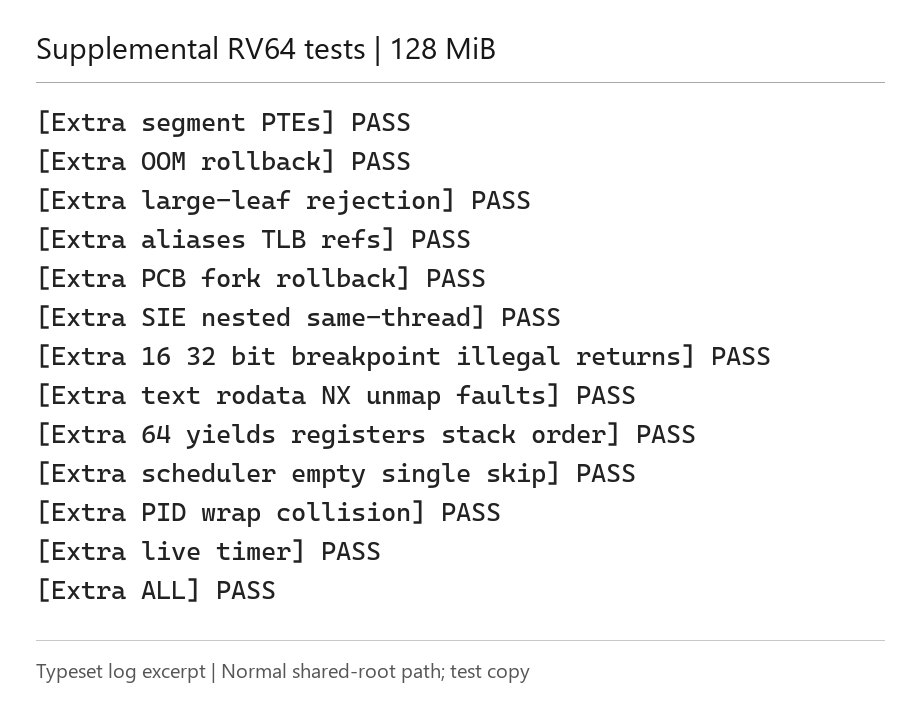
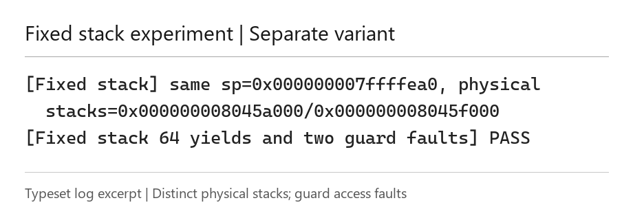

# Lab 4：进程管理实验报告

邹瑛琦（2412744）、丁子昂（2411130）  
实验与验证日期：2026 年 11 月 17～18 日

## 1. 实验目标与整体逻辑

本次实验要让内核能够创建线程，并在多个线程之间切换执行。我们按指导书的三个模块完成了页表映射维护、线程创建与初始化、线程调度，在此基础上补做两个 Challenge、分段权限映射和固定地址内核栈探索。

初始化顺序是：

```text
kern_init
  → pmm_init：物理页管理、映射自检、建立内核页表、初始化 SLOB
  → pic_init / idt_init：准备中断与异常入口
  → vmm_init：检查虚拟内存区域管理
  → proc_init：建立 idleproc，创建 initproc
  → clock_init / intr_enable
  → cpu_idle → schedule → proc_run → switch_to
```

前半段先准备可用内存、地址翻译和异常处理，后半段才创建执行实体并交出 CPU。内核线程共享内核地址空间，每个线程有自己的内核栈和执行现场。本实验采用预映射，没有实现按需分配和页面置换。

代码以当年官网 `lab4.zip` 为主体，包内目录为 `lab4_new`，共 68 个文件。我们按新接口迁入 Lab 2 的物理内存初始化和 Best-Fit，以及 Lab 3 的 Trap 保存、分发和恢复机制，保留本次新增的 VMA、SLOB、线程入口和评分测试。官方包的 SHA-256 为 `7a92f243f88ca9a4ec78b52e554a14d78a41bbf6a79a1275f6cc929aaebceba2`，获取日期为 2026-11-17。

## 2. 功能模块一：页表映射维护

实现位于 [pmm.c](../code/kern/mm/pmm.c)。这个模块需要同时维护 PTE、物理页引用计数和 TLB，单独改其中一项会留下不一致的状态。

### 2.1 建立、替换和撤销映射

`page_insert()` 先取得目标 PTE。若中间页表无法分配，返回 `-E_NO_MEM`，不改变目标数据页的引用。建立映射时先取得新引用，再处理旧项，避免把同一页误当作旧页释放。

| 原地址的状态 | 处理结果 |
| --- | --- |
| 没有映射 | 建立新 PTE，目标页引用加一 |
| 已映射到同一页 | 更新权限，引用数保持不变 |
| 已映射到另一页 | 撤销旧页引用，零引用时还页，再建立新映射 |

`page_remove()` 使用不创建页表的查询路径。没有有效映射时直接返回；存在映射时，由内部 `page_remove_pte()` 清除 PTE、使旧翻译失效并减少引用。连续删除同一地址不会重复还页。

`get_pte()` 负责定位末级项，必要时分配两个中间页表。我们补上了第二次分配失败时的回滚：只释放本次新建的中间表，保留原有父项和映射。函数还会识别上层大页叶项，避免把大页映射的物理内存当作下一层页表。

页表结构变化后使用全局 `sfence.vma`，普通映射更新使用相应地址的失效操作，并加入编译器内存约束。补充测试先读取旧映射，再替换物理页，实际读到新页内容；撤销映射后再次访问则触发预期页故障。

### 2.2 内核分段权限

启动时的大页适合完成最初跳转，但会让代码、只读数据和可写数据共用权限。我们在物理内存初始化后另建普通页表，按链接边界设置：

| 范围 | 权限 |
| --- | --- |
| `.text` | 可读、可执行，不可写 |
| `.rodata` | 可读，不可写、不可执行 |
| 数据段、BSS 和其余可管理 RAM | 可读、可写，不可执行 |

[链接脚本](../code/tools/kernel.ld)将 `etext`、`erodata` 按页对齐。新根表完成映射后写入 `satp` 并刷新 TLB，正式根表不保留启动阶段的粗粒度恒等映射。我们实际尝试写代码、写只读数据和执行数据段，分别观察到预期的页故障。

## 3. 功能模块二：线程创建与初始化

实现位于 [proc.c](../code/kern/process/proc.c)。六个函数共同把内存中的 PCB 组织成能够第一次运行的线程。

| 函数 | 本次实现中的职责 |
| --- | --- |
| `alloc_proc()` | 分配并清零 PCB，设置 `PROC_UNINIT`、pid=-1、内核页表和独立链表节点 |
| `proc_init()` | 初始化全局列表和哈希表，把启动现场登记为 idle，再创建 init |
| `kernel_thread()` | 把函数、参数和初始状态放入临时 trapframe，交给 `do_fork()` |
| `do_fork()` | 取得 PCB、内核栈和初始现场，分配 PID，登记后唤醒；失败时回收已取得资源 |
| `copy_thread()` | 在新栈顶放置 trapframe，设置子返回值和首次运行的 context |
| `copy_mm()` | 保持内核线程的 mm=NULL、共享内核根表；拒绝本阶段不支持的用户 mm |

idle 不是普通 fork 的结果。`proc_init()` 直接让它使用当前启动现场和 `bootstack`，设 pid=0、状态为 RUNNABLE，并置 `need_resched`。init 经过正常创建接口取得独立的两页内核栈，pid=1，父线程为 idle。初始化后总线程数为2，普通进程链表中有 init，idle 单独管理。

我们让 `do_fork()` 在资源准备完成后，再在关中断区域内分配 PID、挂接全局链表与哈希表、增加计数并唤醒。PCB 分配失败直接返回；栈分配失败释放 PCB；地址空间处理失败同时释放栈和 PCB。失败线程不会出现在可运行列表中。

### 首次运行现场

`copy_thread()` 把 trapframe 放在新栈顶，令子现场的 a0=0；默认栈参数为0时，恢复后的 sp 指向该帧位置。context.ra 设置为 `forkret`，context.sp 指向 trapframe。实际执行链是：

```text
switch_to → forkret → forkrets → __trapret → sret
          → kernel_thread_entry → fn(arg)
```

`kernel_thread()` 预先在 tf.s0/tf.s1 中放入函数和参数，tf.epc 指向 `kernel_thread_entry`。SPP 使 sret 返回 S 态，SPIE 为首次返回后的中断状态作准备，保存现场中的 SIE 清零。入口恢复后把 s1 移到 a0，再调用 s0 指向的函数。

## 4. 功能模块三：调度与上下文切换

`cpu_idle()` 持续检查重调度标记；[schedule()](../code/kern/schedule/sched.c) 从当前节点之后循环扫描 RUNNABLE 线程，idle 则从表头开始。找不到候选时使用 idle，选中后增加 `runs`，仅在目标不同于 current 时切换。

`proc_run()` 在中断保护下更新 current，按 RV64 Sv39 格式写入目标页表的物理页号，刷新 TLB，再调用 [switch_to](../code/kern/process/switch.S)。这里没有使用 `libs/riscv.h` 中遗留的 Sv32 `lsatp()`。

`struct context` 保存 ra、sp、s0～s11，共14个64位字段。切换发生在 C 函数调用边界，调用者按 ABI 处理仍需保留的 caller-saved 值，切换汇编保存恢复 callee-saved 现场即可。Trap 可能发生在任意指令边界，因此沿用 Lab 3 更完整的36槽、288字节 trapframe。两者用途不同。

调度和切换的中断保护可以嵌套：外层 `schedule()` 关闭中断后，内层 `proc_run()` 看到原状态为关闭，不会提前重新开启；线程切回原调用点后，再逐层恢复保存的状态。当前时钟处理不自动触发完整的抢占调度，补充线程通过主动调用 `schedule()` 验证轮转。

## 5. spec 和 prompt 的组织

我们按功能闭环组织提示词，将实现与测试分开，文字题的分析提问单列，整理在 [prompt.md](prompt.md)。每条均使用 `[PROMPT]`、`[RELY]`、`[GUARANTEE]`、`[SPECIFICATION]`：分别说明任务和修改边界、真实接口上下文、交付内容、前置与后置条件。

| 模块 | spec 中重点表达的行为 | 对应测试 |
| --- | --- | --- |
| 映射维护 | 成功后的映射、权限、引用和 TLB 一致；失败不留半完成状态 | 同页、换页、别名、幂等删除、分配失败回滚和真实访问 |
| 线程创建 | 可运行前所有资源齐备；失败不登记、不泄漏；首帧位于自己的栈内 | PCB 字段、两类分配失败、mm 拒绝、数量上限、PID 与栈检查 |
| 调度切换 | 选择合法候选，current/页表/现场一致，切回后保持寄存器和中断状态 | 64次主动让出、状态跳过、空集、单候选、SIE、GDB首入链 |

例如，对 `page_insert()`，我们没有只给出“先调用哪个函数、再写哪个变量”的步骤，而是要求：同页重插不多占引用，替换页正确撤销旧引用，分配失败时原映射、目标引用和页数保持。这样才能用独立状态检查发现遗漏。后续发现的回滚和测试输入问题作为迭代记录保留，没有写成第一版就已预见的结果。

## 6. 测试与调试结果

### 6.1 环境和官方评分

环境为 WSL Ubuntu、GCC 13.2.0、Make 4.3、QEMU 8.2.2、gdb-multiarch 15.1；客体为单 hart 的 RV64/Sv39 内核。官方 `make grade` 将测试注入临时副本，PMM、Process Create、Schedule 各10分，本轮结果为 **30/30**，退出状态为0。

2026-11-18 推送前，我们从待提交版本导出独立副本，重新运行官方评分、三种内存配置、固定栈变体、七项合成边界和客体 GDB，均通过。源码与11月17日记录一致，摘要见 [推送前复测记录](evidence/acceptance-20261118.json)。下列配图保留11月17日的原始记录。


图1：官方评分日志摘录排版图，原始摘录见 [grade.txt](evidence/grade.txt)。三个分项均通过。

### 6.2 评分外验证

我们以真实读写、独立计数和预期状态补充评分未覆盖的情况：

| 验证项 | 本轮结果 |
| --- | --- |
| 映射、别名、替换和重复删除 | PTE/ref/空闲页状态一致，替换后实际读到新页 |
| 页表分配失败 | 第一次、第二次及已有路径下的失败均回滚；不破坏旧映射 |
| PCB 与 fork 失败 | PCB/栈不足、mm 不支持、线程数上限均按预期拒绝，链表和计数不增加 |
| 多轮切换 | 两个线程各32轮，共64次主动让出；寄存器、局部栈值和交替顺序正确 |
| 调度边界 | 跳过不可运行状态，空集回退 idle，单候选不额外切换 |
| PID 回绕 | 高端 PID 经真实接口登记后，回绕仍避开在用 PID |
| 中断与异常 | SIE 初始开/关及嵌套恢复正确；真实时钟到达；16/32位断点和非法指令均返回 |
| 分段权限与撤销映射 | 写 text/rodata、执行 data、访问刚撤销映射均触发预期页故障 |



图2：128 MiB QEMU 补充验证的日志摘录排版图，见 [extra-rv64.txt](evidence/extra-rv64.txt)。受控故障恢复和分配失败注入仅在测试副本中启用。

我们还分别以64、128、256 MiB 的真实 QEMU 内存配置运行补充测试，均通过。256 MiB 配置按框架上限管理前128 MiB。

另有七项在客体副本中合成的 `page_init()` 输入：无效基址、零大小、地址溢出、无法容纳内核、描述符空间不足、没有剩余整页和仅剩碎片。前五项按预期终止初始化，后两项没有登记空闲整页。这七项是合成边界验证，与三种真实内存配置分开记录在 [results.json](evidence/results.json)。

### 6.3 客体 GDB

我们用正常构建的 ELF 连接暂停的 QEMU，实际停在初始化、调度、保存现场和首次恢复链上的10个位置。`switch_to` 保存 idle 现场后，新 context 中的 ra 使执行转到 forkret；sret 后抵达线程入口，再进入 init_main。图3保留了本次 current、sp 和 satp 的观察。


图3：客体 GDB 日志摘录排版图，完整输出见 [guest-gdb.txt](evidence/guest-gdb.txt)。该图中的地址对应本次正常 ELF，散列保存在 results.json。

这里的 GDB 观察对象是客体内核。本轮没有以宿主 GDB 调试 QEMU 内部 TLB 实现。

## 7. 生成、定位与修正过程

我们先依据接口和约束整理需求，再借助 AI 补全代码、分析失败，并用构建、QEMU 和 GDB 核对结果。实际遇到的问题如下：

| 问题 | 定位过程 | 修正和复测 |
| --- | --- | --- |
| 官方骨架缺少 `best_fit_pmm.h` | 原包首次编译即报缺头文件；检查发现默认管理器入口与留下的 Best-Fit 检查不匹配 | 迁入已有 Best-Fit，适配 `default_pmm_manager`；原分配器检查体保留 |
| loader 启动只有固件输出 | 同一镜像对照显示 loader 的固件下一跳为0，`-kernel` 为0x80200000 | 运行、调试和评分的装载参数改用 `-kernel`，保留评分条件 |
| 进入物理入口后停在启用分页处 | GDB 单步到写 satp 后，PC=0x80200038 无法继续翻译 | 补物理过渡映射、精确栈顶和优先入口节，复测进入 C 初始化 |
| 非叶 U 位与自检冲突 | 独立最小探针只改一个 U 位：清零时读到0xabc，置位时出现 load page fault；再对照规范 | 非叶项只置 V；同步把旧根 U 断言改为规范非叶标志检查，其余断言和三项评分测试保留 |
| 页表分配失败后少一页 | 注入第二次分配失败，返回错误但空闲页数减少 | 只回滚本次新建路径；原失败与修正后的守恒结果分别保留 |

测试代码本身也需要满足接口前提。PID 探针最初绕过真实分配接口插入高端 PID，破坏了 `get_pid()` 的缓存约定；改为经真实接口登记后，回绕检查通过，未修改分配器。边界探针曾在 `va_pa_offset` 初始化前调用 PADDR 构造输入，改用固定映射偏移后复测通过，生产 `page_init()` 保持不变。

推送前还修正了材料脚本对 ELF 的误判：异目录构建会改变调试信息中的目录，从而改变 ELF 散列。本次重新构建的裸镜像与原镜像逐字节一致。材料检查默认核对源码，精确核对历史 GDB 文件则使用 `--check-recorded-elf`；已验证异目录重建可通过，源码改动仍会被拒绝。

## 8. Challenge 与正文探索

### 8.1 Challenge 1：保存和恢复中断

`local_intr_save(flag)` 读取 `sstatus.SIE`。原来开启时，清除 SIE 并保存1；原来关闭时保存0。`local_intr_restore(flag)` 仅在 flag=1时重新开启，因此进入前已关中断的代码不会被这一层退出操作提前开启。

嵌套时，外层若保存1，内层看到的就是0。内层先退出仍保持关闭，外层退出再恢复开启。这个用法要求临界区内不自行开启中断，并按相反顺序恢复。它只约束当前 hart，不能替代多核锁。本轮对初始 SIE=0/1 都做了两层嵌套和实际切回检查，结果符合预期。

### 8.2 Challenge 2：分页模式和接口划分

| 模式 | 适用架构 | 页表级数 | 每级索引 | PTE大小 / 每表项数 | 普通页大小 |
| --- | --- | --- | --- | --- | --- |
| Sv32 | RV32 | 2 | 10位 | 4字节 / 1024项 | 4 KiB |
| Sv39 | RV64 | 3 | 9位 | 8字节 / 512项 | 4 KiB |
| Sv48 | RV64 | 4 | 9位 | 8字节 / 512项 | 4 KiB |

三者都逐级取索引，读取表项并找到下一层。Sv39 的 `get_pte()` 两段相似代码，分别完成根表到中间表、中间表到末级表的定位或分配。最后根据 PTX 返回末级项地址，不在这里分配数据页。对应普通页路径，Sv32只有一个这样的非叶下钻步骤，Sv48有三个。

三种模式的普通页内偏移均为12位，虚拟地址分别使用32、39、48位。Sv39/Sv48还要求RV64地址的高位按有效地址最高位作符号扩展。增加级数扩大了可表示的地址空间，也增加了完整走表的层数。

把查询和分配合并，调用者能通过 create 参数选择行为，接口较紧凑；代价是查询路径与资源所有权混在一起，容易遗漏失败副作用。本轮第二次分配失败留下页表页，就是一个实际例子。

对当前规模，我们保留公开接口并补齐事务性回滚。以后若增加更多分页模式或大页拆分，可以把只读查询和确保路径存在拆为内部接口，并明确错误及新资源的归属。拆函数本身不会自动解决回滚问题，还需约束二者如何配合。Sv32/Sv48的比较依据规范，本轮实际运行的是Sv39。

### 8.3 固定地址内核栈探索

我们在独立变体中，为两个线程使用不同根表，共享高地址内核映射，把各自不同的物理栈映到相同区间 `[0x7fffe000, 0x80000000)`，下方留一页不映射。PCB 保留栈的稳定直映地址，运行 sp 使用别名。

不能在旧 sp 上先换页表再继续执行 C，因为相同数值会立即指向另一个线程的栈。变体先保存旧现场，转到共同过渡栈，再写 satp、刷新 TLB 并恢复新现场。



图4：固定栈变体的独立运行日志摘录排版图，见 [fixed-stack.txt](evidence/fixed-stack.txt)。两个线程观察到相同 sp、不同物理栈，64次主动让出后数据仍独立，分别向保护页写入时都触发预期故障。

Linux v6.12 的 RISC-V `__switch_to` 保存同类整数现场，VMAP_STACK 的溢出路径另换紧急栈。它为虚拟栈、保护页和异常栈处理提供了对照，但不等于 Linux 把所有线程栈都固定在同一个 VA。本变体只验证了受控保护页访问，尚未实现 sp 已越界后的通用紧急栈恢复。默认内核仍使用共享根表及各线程的直映栈。

## 9. 与 OS 原理的对应

| 原理知识 | 本实验的对应实现与差异 |
| --- | --- |
| 地址空间与分页 | VMA描述区间，三级页表执行翻译；本次预映射，不包含按需缺页和换页 |
| 资源管理与引用计数 | 映射引用与页的分配归属配合，零引用时还页；中间页表另有生命周期 |
| 进程和线程 | PCB统一表示执行实体；本次是共享内核地址空间的线程，没有独立用户地址空间 |
| 上下文与中断现场 | 函数调用边界保存14个整数现场字段，Trap保存更完整的GPR/CSR状态 |
| 调度与并发 | 通过顺序轮转和主动调度共享一个CPU；没有完整抢占、优先级或多核调度 |
| 临界区 | 保存原SIE并局部关中断，保证单hart切换过程一致；不能推导为多核互斥 |

本次尚未覆盖用户进程装载、系统调用、写时复制、页面置换、完整退出等待与资源回收、多核同步等内容。`do_exit()` 仍是骨架的占位 panic，因此正常运行在 init 输出后到达该位置，不能把它解释为完整退出成功。

## 10. 复现入口与来源

在 WSL Ubuntu 中进入本实验 `code/`：

```sh
make
make qemu
make grade
python3 tools/tests/run_lab4.py --segments --output /tmp/lab4-extra-report1
python3 tools/tests/run_lab4.py --segments --fixed-stack --output /tmp/lab4-fixed-report1
```

输出目录应尚不存在。两终端调试分别执行 `make debug` 和 `make gdb`；自动观察脚本为 `tools/tests/debug_lab4.py`。正常运行的占位 panic、补充测试的明确标记后关机是不同路径。具体参数见 [验证入口说明](../code/tools/tests/README.md)，材料静态核对可运行 `python3 report/scripts/verify_materials.py`（从实验根目录）。

来源：

1. [2026 Lab 4指导书与练习](http://oslab.mobisys.top/lab2026/_book/lab4/lab4_2_1_exercises.html)、[报告要求](http://oslab.mobisys.top/lab2026/_book/lab4/lab4_5_labs_requirement.html)，获取于2026-11-17。
2. [公共四段式提示词规范](http://oslab.mobisys.top/lab2026/_book/lab0.5/3_prompt_structure.html)。
3. [RISC-V Supervisor-Level ISA 1.13](https://docs.riscv.org/reference/isa/v20260120/priv/supervisor.html)，用于核对分页模式、非叶标志和中断状态。
4. [Linux v6.12 RISC-V entry.S](https://github.com/torvalds/linux/blob/v6.12/arch/riscv/kernel/entry.S)、[同版本VMAP_STACK文档](https://github.com/torvalds/linux/blob/v6.12/Documentation/mm/vmalloced-kernel-stacks.rst)。
