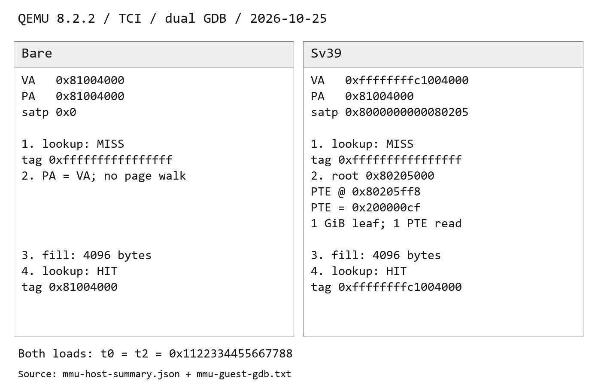
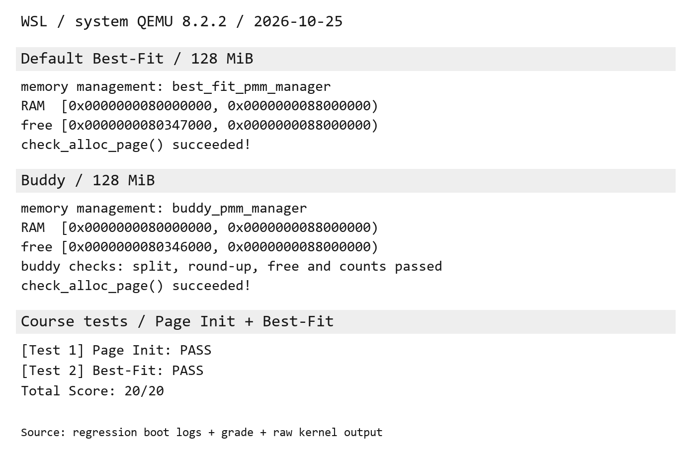

# Lab 2：物理内存管理与地址翻译

小组成员：邹瑛琦（2412744）、丁子昂（2411130）  
实验与复核日期：2026-10-21 至 2026-10-25。

## 1. 实验思路与任务规范

这次实验先回答“哪些物理页可以分配”，再回答“怎样分配和回收连续页”，最后观察一次访存怎样经过页表和 TLB。我们一起完成并复核了内存初始化、Best-Fit、Buddy，以及 QEMU 源码调试。启动链为：OpenSBI → `kern_entry` 建立引导映射和栈 → `kern_init` 解析 DTB → `pmm_init` 注册空闲页并运行分配器自检。

任务规范先写输入、目标行为和不能破坏的条件，再据此写提示词与测试。完整提示词及整理来源见 [prompt.md](prompt.md)。

| 任务 | spec 中的主要约束 | 提示词 | 验证方法 |
| --- | --- | --- | --- |
| `page_init` | 读取 DTB；保留固件、内核和描述符；只登记完整空闲页 | P2 | 内核自检、课程测试、7 项边界检查 |
| First-Fit 分析 | 解释四个核心函数、拆分与合并，回答改进问题 | P3 | 阅读原实现，并切换 First-Fit 启动 |
| Best-Fit | 选最小足够块；维护链表和计数；保留给定检查函数 | P4 | 默认启动、课程评分、独立占用模型 |
| Buddy 实现 | 分阶链表、向上取整、拆分、同阶伙伴合并 | P5 | 独立管理器启动 |
| Buddy 测试 | 实现与测试分开规定；覆盖对齐、容量、计数及合并 | P6 | 内核自检、固定种子压力序列和耗尽回收 |
| 页表与 TLB 调试 | 实际执行访存；记录 QEMU 调用、分支、翻译及命中情况 | P8、P9 | 双 GDB，比较 Bare 和 Sv39 |

## 2. 发现物理内存并建立页描述符

实现位于 [`page_init`](../code/kern/mm/pmm.c)，保留了 `lab2` 和学号注释。`dtb_init` 解析 `/memory` 节点后，`page_init` 读取基址和容量。当前 `pa2page` 的索引约定以 `DRAM_BASE = 0x80000000` 为起点，因此基址必须与之相符；零容量、地址加法溢出、容量不足以放下内核或描述符时直接报错。

初始化分为三步：

1. 将 DTB 末端限制在 `PHYSICAL_MEMORY_END = 0x88000000` 内，设置虚实地址偏移。`npage = PPN(mem_end)` 是物理页号上界，描述符数量为 `npage - nbase`，不能把 `npage` 直接理解成 RAM 页数。
2. 将 `pages` 放在链接符号 `end` 后的第一个页边界，先把所描述的页全部标为保留。`Page` 数组存的是引用计数、标志和链表节点，数组本身也占用 RAM。
3. 将描述符末端向上对齐、内存末端向下对齐，只把二者之间非空的完整页区间交给 `init_memmap`。若没有完整空闲页，就不调用 `init_memmap(0)`。

128 MiB 配置下，本轮默认 Best-Fit 镜像打印 RAM 范围 `[0x80000000, 0x88000000)`、空闲范围 `[0x80347000, 0x88000000)`。起点来自内核与描述符的实际大小，不能写死。64 MiB 配置正常启动；256 MiB 配置中 DTB 报告更大 RAM，但本内核仍只管理至上述上限。

对硬件内存发现思考题，我们的理解是：操作系统通常从固件或引导协议接收内存布局；本实验使用 QEMU 生成的 DTB。直接试写物理地址可能碰到设备，也不能可靠判断所有 RAM。若扩展到多段 RAM，应解析多个区间并排除保留区。本次未实现额外的硬件探测器。

## 3. 连续页分配与回收

### 3.1 First-Fit：取第一个足够大的块

课程已提供 [`default_pmm.c`](../code/kern/mm/default_pmm.c)。四个核心函数的职责如下：

| 函数 | 作用 |
| --- | --- |
| `default_init` | 初始化空闲链表头，将空闲页计数置零 |
| `default_init_memmap` | 清理可用页的保留状态，在连续区间首页记录长度，按地址登记空闲块 |
| `default_alloc_pages` | 从头寻找首个足够大的块，摘下后切出请求页数，把余块放回链表，扣减计数 |
| `default_free_pages` | 按地址插回释放区间，与相邻前块、后块合并，恢复计数 |

例如，地址依次递增的空闲块大小为 8、4、10 页，申请 3 页时 First-Fit 选择 8 页块，留下 5 页；Best-Fit 则选择 4 页块，留下 1 页。地址有序有利于判断相邻关系，分配策略决定从哪些块中选择。

First-Fit 可以改进。next-fit 从上次结束处继续找，能减少反复从低地址开始搜索；分级链表或大小索引能减少查找开销，但需要维护额外状态。这些改动都不能保证消除外部碎片。

### 3.2 Best-Fit：选择最小足够块

[`best_fit_pmm.c`](../code/kern/mm/best_fit_pmm.c) 实现六个管理器回调及注册结构：`init`、`init_memmap`、`alloc_pages`、`free_pages`、`nr_free_pages`、`check`。`pmm.c` 默认选择 `best_fit_pmm_manager`，课程给定的 `basic_check` 和 `best_fit_check` 保持原样。

分配时完整扫描地址有序链表，用 `property >= n` 筛出候选，再保留其中最小的一块；相同大小时保留先遇到的低地址块。选中后清除原首页的空闲属性，余块建立新的首页、长度和链表节点。释放时先按地址插入，再分别检查前后块是否物理相邻，合并后清除被吸收首页的属性。每次分配、回收都同步维护 `nr_free`。

Best-Fit 尽量保留大块，但可能留下难以利用的小块，而且本实现每次都要扫描完整链表。可以增加按大小的索引减少搜索，代价是同时维护大小索引和地址关系。本次保留地址有序链表，便于检查合并过程。

### 3.3 Buddy：按 2 的幂分阶管理

[`buddy_pmm.c`](../code/kern/mm/buddy_pmm.c) 为 0～17 阶分别建立链表，第 `k` 阶的块有 `2^k` 页。初始化时，根据描述符索引的对齐情况和剩余长度，逐段拆出尽可能大的合法块，因此无需空闲区起点恰好位于大块边界。

`alloc_pages(n)` 将请求向上取整，找到相应或更高阶的空闲块，再逐级对半拆分。`free_pages(base,n)` 根据 `index XOR 2^k` 找伙伴，只有伙伴在范围内、标为空闲且大小相同才合并。首页 `property` 保存实际容量，空闲计数也按容量变化：申请 3 页占 4 页，申请 5 页占 8 页，多出的部分是内部碎片。

释放校验比较的是取整后的容量。例如 3 和 4 都对应 4 页，当前记录不能区分这两个原始请求；调用者仍应传回原申请页数。若要校验原始请求，还需另存请求长度。

Buddy 内核自检覆盖 1、3、5 页请求、零页及超过支持阶数的请求，并遍历链表核对大小、对齐、空闲总页数，以及没有留下可合并的同阶伙伴。只检查“释放后页数恢复”不够，因为两个小块一直分开也能保持计数正确。

我们又用真实分配器 C 源码配合独立占用数组，对 Best-Fit 和 Buddy **各执行 20,000 次固定种子操作**。初始范围从描述符索引 3 开始，共 3001 页；每次检查返回块不越界、不重叠及页数守恒，Best-Fit 还与独立计算的最小足够空闲段比较。之后逐页耗尽，再逆序回收并重跑管理器检查。ASan/UBSan 运行通过。这补充了交错分配与回收的检查；RISC-V 启动和页表行为仍由 QEMU 验证。

## 4. 用两个 GDB 观察页表与 TLB

### 4.1 调试对象和访存指令

普通宿主 GDB 调试 QEMU 的 C 源码，`gdb-multiarch` 通过远程接口调试客体 RISC-V。调试版采用官方 QEMU 8.2.2 源码，保留独立构建，不替换系统 QEMU。启用 `--enable-debug --enable-tcg-interpreter` 和 `-O0 -g3`，使本次两次加载的命中、未命中路径都可在 C 层观察；构建配置和散列见[构建记录](evidence/2026-10-25-qemu-build-manifest.json)。

客体 GDB 在暂未使用的 RAM 中放置 `sfence.vma; ld t0,0(t1); ld t2,0(t1); ebreak`，并在 `ebreak` 前设硬件断点。先在 `satp=0` 的 Bare 状态执行，再到高地址 `kern_init` 处执行 Sv39 版本。目标数据为 `0x1122334455667788`，两次加载均得到该值。探针完成后恢复被借用内存、寄存器和 PC，内核源码无需加入测试指令。

### 4.2 一次 Sv39 翻译的实际数值

目标虚拟地址为 `0xffffffffc1004000`。此时：

```text
satp             = 0x8000000000080205
root physical    = 0x80205000
VPN[2]           = 511
PTE address      = 0x80205000 + 511 * 8 = 0x80205ff8
PTE              = 0x200000cf
physical address = 0x81004000
```

`get_physical_address` 先由 `satp` 取得模式和根页表物理地址，再检查虚拟地址高位，按 VPN 索引读取 PTE。这个 PTE 的 V、R、W、X、A、D 位为 1，根层就遇到有效叶子，且满足大页对齐要求，所以本次只读了 **1 个 PTE**，没有继续查下两层。根层叶子覆盖 1 GiB，物理地址计算为：

```text
PA = 0x80000000 | (VA & 0x3fffffff) = 0x81004000
```

因此 Sv39 的“三层结构”不意味着每次都读取三层。一般查表时，循环从 VPN[2] 向 VPN[0] 推进，PTE 地址为当前页表基址加索引乘 8；遇到非叶子，就以 PTE 的物理页号左移 12 位作为下一级页表基址。本次根层已是大页叶子，循环直接完成翻译。无效 PTE、权限不符或大页未对齐会转入失败处理。图 1 汇总了翻译现场与两次加载的区别。

### 4.3 先查 TLB，未命中才进入翻译

本次 TCI 数据加载的调用路径为：

```text
tci_qemu_ld → helper_ldq_mmu → do_ld8_mmu → mmu_lookup → mmu_lookup1
  未命中 → victim_tlb_hit；仍未命中 → tlb_fill
         → riscv_cpu_tlb_fill → get_physical_address
         → tlb_set_page → 完成本次加载
  命中   → 使用已有 fulltlb/宿主地址信息完成加载
```

在 QEMU 8.2.2 的 `accel/tcg/cputlb.c` 中，`mmu_lookup1` 的 `if (!tlb_hit(...))` 是本次观察的关键分支。第一次标签为 `0xffffffffffffffff`，进入 1711 行附近的未命中路径；第二次标签已匹配目标地址，越过该分支，进入 1721 行附近的 `fulltlb` 处理。`target/riscv/cpu_helper.c` 中，Bare 分支直接得到客体物理地址；Sv39 则读取 PTE、判定有效性与叶子、检查对齐和权限，再组合物理地址。这里的行号对应所用 8.2.2 源码。



图 1：2026-10-25 双 GDB 实测数据的排版图，来源为 [8 条结构化观察](evidence/2026-10-25-mmu-host-summary.json)和[客体加载日志](evidence/2026-10-25-mmu-guest-gdb.txt)。Sv39 的页表叶子为 1 GiB，本次 `tlb_set_page` 的填充大小为 4096 字节，二者含义不同。

### 4.4 Bare 对比带来的理解

| 观察项 | Bare | Sv39 |
| --- | --- | --- |
| 客体访问地址 | `0x81004000` | `0xffffffffc1004000` |
| 得到的客体物理地址 | `0x81004000` | `0x81004000` |
| 页表遍历 | 无，直接返回地址 | 根层读取一个大页叶子 |
| 本次 QEMU 软件 TLB | 首次未命中、填充，第二次命中 | 首次未命中、填充，第二次命中 |

最直观的现象是：Bare 没开启客体分页，QEMU 仍使用软件 TLB。原因是模拟器还要把客体地址对应到宿主 RAM，并缓存访问属性；真实 CPU 在 Bare 下不需要这一步客体页表翻译。QEMU 的软件缓存是实现模拟访存的机制，不能直接当成物理 CPU 的 TLB 结构。本次使用 TCI 便于看清 C 调用路径；原生 TCG 的命中快路径还可出现在生成的宿主指令中，这次调试也不用于比较硬件性能。

调试中两处细节很有帮助。开始把宿主断点的启用时机放在内核取指，Bare 探针却已在此前执行，因而漏掉首轮观察；改在探针首次取指时启用条件断点，才完整记录两次加载。另一次 `next` 停在物理地址赋值的续行，变量尚未更新；改在赋值完成后读取，才得到 `0x81004000`。AI 帮助定位了这些时序和源码位置，最终以分支单步、变量值及客体加载结果核对。

## 5. 构建、测试与修正

初次记录使用 Windows 的 GCC 10.2、Make 4.2.1、QEMU 5.1；后续复测使用 WSL Ubuntu 24.04.1、RISC-V GCC 13.2、Make 4.3、系统 QEMU 8.2.2 和 GDB 15.1。源码级调试使用上述独立 QEMU 构建。环境、可执行命令和证据索引集中在[核验记录](verification.md)。

| 实际检查 | 核验日 | 结果与范围 |
| --- | --- | --- |
| 构建、64/128/256 MiB 默认启动、切换 Buddy/First-Fit、恢复默认、评分及原始内核标记 | 10-25 | 14 项检查通过；课程评分 20/20，覆盖 Page Init 和 Best-Fit |
| Best-Fit、Buddy 各 20,000 次操作及耗尽回收 | 10-22 | 独立占用模型检查通过，ASan/UBSan 无报错 |
| `page_init` 7 项边界 | 10-22 | 非法信息报错、尾页截断和零完整空闲页符合预期 |
| 客体页表与虚实地址字节核对 | 10-22 | `satp`、根 PTE 与指令字节对应 |
| QEMU 源码级 Bare/Sv39 加载 | 10-25 | 首次未命中、翻译/填充、再次命中；加载值均正确 |



图 2：2026-10-25 的默认、Buddy 运行日志与课程评分摘录排版图，完整日志见[核验记录](verification.md)。课程评分不包含 Buddy 与 QEMU 调试。

本轮遇到并修正的问题如下；较早的入口节修正也保留在 [AI 过程记录](ai-process.md)中。

| 现象 | 定位与修正 |
| --- | --- |
| QEMU 8.2.2 只到 OpenSBI，内核无输出 | GDB 和异常跟踪显示开启 `satp` 后在 `0x80200038` 发生取指页故障。原根页表只有高地址映射，补上根索引 2 的 1 GiB 恒等映射，覆盖切换后的低地址指令，随后跳到高地址入口 |
| WSL 中评分脚本出现回车字符错误 | 将 shell/Python/Makefile 类文件约定为 LF，核对检出格式后重跑 |
| 修改分配模式可能沿用旧目标文件 | Makefile 记录编译器与有效编译参数，配置变化自动触发重编译；默认、Buddy、First-Fit 连续切换验证通过 |
| 原评分依赖固定副本路径，失败信息与清理不稳 | 使用独立临时副本、保留原课程检查、传回构建失败并清理本次进程；另用故意失败的编译命令验证失败不会被当成通过 |
| GDB 把带引号的内核路径当作实际文件名 | 根据启动方式改用已知工作目录下的 `bin/ucore.img`，再跑完整双 GDB 流程 |
| GDB 分离后 QEMU 留在另一进程组 | 记录本次 inferior PID，并匹配二进制与随机端口后清理；最终检查没有遗留本次探针进程 |

内核自检打印完成后会循环等待，自动脚本在观察窗口结束时停止 QEMU；结束模拟器不表示内核自行关机。边界测试只在临时副本覆写 DTB 查询值，其中零完整空闲页用例跳过要求分配成功的常规自检，专门核对初始化后空闲计数为零。

## 6. 与操作系统原理的联系

| 实验对象 | 对应原理及关系 | 本实验中的具体范围 |
| --- | --- | --- |
| DTB、保留页与 `Page` 数组 | 物理内存布局、内核元数据管理 | 描述 RAM 并排除占用区；描述符不是页内容 |
| First-Fit、Best-Fit | 连续空间分配与外部碎片 | 找到可用连续页块，并在释放时合并 |
| Buddy | 分级分配、内部碎片 | 按 2 的幂管理容量；分配 3 页占用 4 页 |
| 引导页表、`satp`、PTE | 虚实地址映射与权限 | 静态大页映射；物理页分配器本身不建立新的进程映射 |
| QEMU 软件 TLB | 地址转换缓存与访问加速 | 观察功能路径，同时包含客体到宿主的模拟开销 |

进程间地址空间隔离、缺页后的按需分配、写时复制、页面置换与交换，以及多核并发下的分配器锁都很重要，但本实验没有实现。它们需要把物理页分配与进程、页表更新及异常处理结合起来。SLUB 对象分配器是指导书的选做 Challenge，本次未实现。

## 7. 参考与附属记录

- [Lab 2 练习要求](http://oslab.mobisys.top/lab2026/_book/lab2/lab2_2_1_exercise.html)、[实验报告要求](http://oslab.mobisys.top/lab2026/_book/lab2/lab2_5_labs_requirement.html)、[QEMU 页表与 TLB 调试要求](http://oslab.mobisys.top/lab2026/_book/lab2/lab2_4_qemu_mmu_debug.html)。
- QEMU 8.2.2 官方源码：[cputlb.c](https://github.com/qemu/qemu/blob/v8.2.2/accel/tcg/cputlb.c)、[cpu_helper.c](https://github.com/qemu/qemu/blob/v8.2.2/target/riscv/cpu_helper.c)。
- [关键提示词](prompt.md)、[AI 辅助分析与修正](ai-process.md)、[分配器复核](allocator-review.md)、[构建与运行核验](verification.md)。
