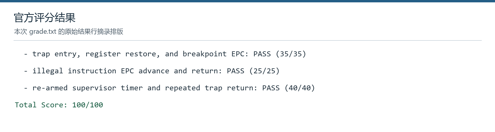
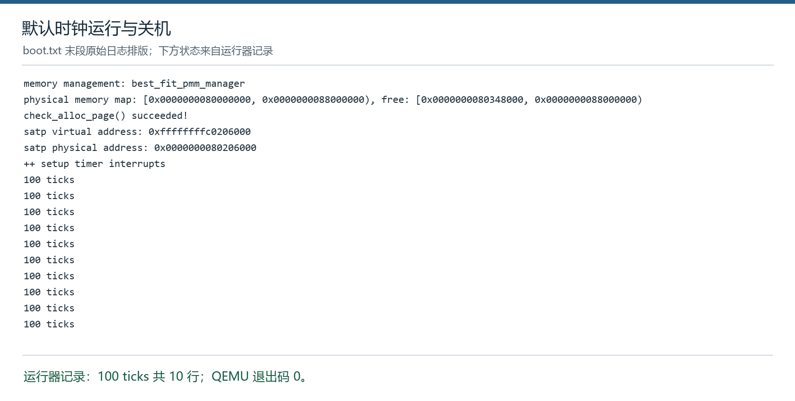
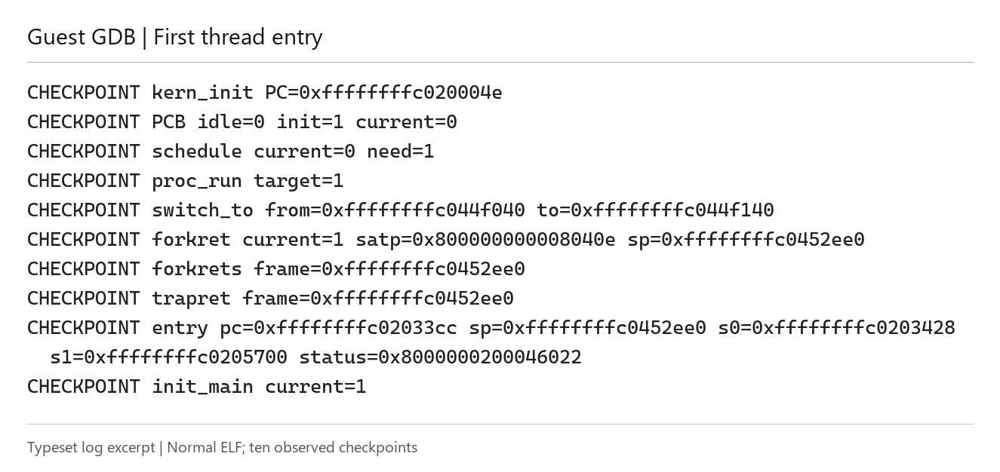

# Lab 3 实验报告：中断与异常

小组：邹瑛琦（2412744）、丁子昂（2411130）

实验日期：2026-11-04

## 1. 实验目标与整体流程

这次实验要让内核在发生中断或异常后，保存现场、完成处理，再恢复到原来的执行流。我俩一起协作，使用 AI 辅助实现和测试设计，先补足 Lab 2 的内存管理依赖，再完成汇编入口与恢复，最后处理时钟、断点和非法指令。

本次使用当前课程 Lab 3 骨架。练习有两个功能模块，需补全 `RESTORE_ALL`、`__alltraps`、`interrupt_handler()`、`exception_handler()`。正文还有 stvec 编码兼容与 `do { ... } while (0)` 两处思考。当前指导书及助教通知已取消旧版 Challenge，本年度没有对应实现题。

初始化先清理 BSS、读取 DTB、初始化控制台，再设置 Trap 入口并初始化物理内存。官方 `init.c` 在内存初始化前后各调用一次 `idt_init()`；随后 `clock_init()` 设置定时器和 `sie` 中的时钟使能位，最后由 `intr_enable()` 打开 `sstatus.SIE`。

```text
执行内核代码
  → 硬件记录 sepc、scause、stval 和 sstatus
  → __alltraps：SAVE_ALL 保存寄存器与 CSR
  → a0 = trapframe 地址，调用 trap()
  → trap_dispatch() 按原因分发
  → interrupt_handler() / exception_handler()
  → __trapret：RESTORE_ALL 恢复现场
  → sret 按 sepc 和 sstatus 返回
```

硬件不会自动把所有通用寄存器压栈，这部分由入口汇编完成。本实验运行在 QEMU 模拟的 RV64 单 hart 环境，实际验证的是 S 态内核发生 Trap 后返回 S 态。

环境沿用 WSL2 Ubuntu：RISC-V GCC 13.2.0、Make 4.3、QEMU 8.2.2、gdb-multiarch。代码在本仓库 `code/`，关键提示词见 [prompt.md](prompt.md)，原始验证记录见 [evidence/README.md](evidence/README.md)。

## 2. Lab 2 继承与启动接入

本部分的 spec 是：在 Lab 3 的接口和同步机制下，提供正确的可用物理页范围与分配器，能够通过框架原有自检。

`page_init()` 从 DTB 取得内存基址和容量，检查范围后按当前映射支持的 `0x88000000` 上限裁剪；在内核末尾按页对齐放置 `Page` 描述符，先把管理范围内的页标记为保留，再把描述符数组之后的完整物理页交给分配器。这样 OpenSBI、内核和描述符自身都不会被当作空闲页。

Best-Fit 维护按地址排列的空闲块，申请时查找最小的足够块，拆分余量；释放时与地址相邻的前后块合并。默认选 Best-Fit，也保留 `PMM=first_fit`。First-Fit 继承了 Lab 2 已定位的两处尾插 `break` 修复。

继承时只取必要实现，保留 Lab 3 的 `Page` 原子标志接口，以及 `alloc_pages/free_pages/nr_free_pages` 的中断保存恢复。启动部分使用专门入口节和过渡恒等映射，保留骨架中栈顶完整地址的计算；QEMU 使用本机可工作的 `-kernel` 装载。

实现提示词 [P1](prompt.md#p1) 先列出继承位置、内存边界与不可覆盖的 Lab 3 接口。验收同时使用两种分配器的内核自检、分配回收守恒，以及 64/256 MiB 内存配置；256 MiB 配置仍按当前映射上限管理 128 MiB。

## 3. 功能模块一：现场恢复与 Trap 入口

### 3.1 Spec 与提示词

输入是 `SAVE_ALL` 已建立的 Trap frame；输出是可供 C 处理函数访问的现场，以及处理后能由 `sret` 继续执行的状态。约束是保持 `SAVE_ALL`、`struct trapframe` 和 `trap(struct trapframe *tf)` 签名不变。

写 spec 时，我们先把实际偏移列清楚，再要求 AI 实现恢复顺序。实现稿见 [P2](prompt.md#p2)，独立测试稿见 [P3](prompt.md#p3)。两稿分别描述“应该怎样恢复”和“怎样观察恢复是否正确”。

### 3.2 Trap frame 与 RESTORE_ALL

RV64 的每个槽为 8 字节，共 36 个槽，占 288 字节，仍保持栈的 16 字节对齐。

| 内容 | 槽号 | 字节偏移 |
| --- | --- | --- |
| x0～x31 | 0～31 | 0～248 |
| 原始 sp，即 x2 | 2 | 16 |
| sstatus | 32 | 256 |
| sepc | 33 | 264 |
| stval（结构中名为 badvaddr） | 34 | 272 |
| scause | 35 | 280 |

`SAVE_ALL` 先通过 `sscratch` 留住原 sp，再减小 sp 分配 frame，最后把原 sp 放进槽 2。因此恢复时不能提前加载 x2，否则后续加载就会离开当前 frame。`RESTORE_ALL` 先用临时寄存器读取并写回 `sstatus/sepc`，随后恢复通用寄存器，最后执行 `LOAD x2, 2*REGBYTES(sp)`。x0 的值由硬件固定为零；scause 和 stval 用于诊断，无须作为返回执行状态写回。

### 3.3 __alltraps、__trapret 与 sret

`SAVE_ALL` 后的 sp 正是 frame 地址。入口执行 `mv a0, sp`，按 RISC-V ABI 把它作为第一个参数，再执行 `jal trap`。C 函数返回时 sp 应仍指向同一个 frame，于是可以继续恢复。

```asm
__alltraps:
    SAVE_ALL
    mv a0, sp
    jal trap
__trapret:
    RESTORE_ALL
    sret
```

进入 S 态 Trap 时，硬件把原 SIE 保存到 SPIE、清零 SIE，并用 SPP 记录来源。恢复保存的状态后，`sret` 按 SPP 选择返回特权级，把 SPIE 送回 SIE，并按 sepc 取回执行位置。因此恢复代码保留保存值，不额外强制修改 SPP。

## 4. 功能模块二：中断与异常处理

### 4.1 Spec 与提示词

输入是带有原因和返回地址的 `trapframe`；输出是相应提示、更新后的计数或返回位置，达到条件时关机。中断不能随意移动 epc；断点和非法指令要按编码长度跳过；其他异常只做框架要求的现场输出。两个处理函数的签名和既有 Trap 函数保持不变。

实现稿 [P4](prompt.md#p4) 明确原因分类、每次时钟行为、关机条件和异常偏移；测试稿 [P5](prompt.md#p5) 单独列出边界、真实指令组合和退出判据。

### 4.2 时钟和其他中断

`trap_dispatch()` 通过 scause 最高位区分中断与异常；`interrupt_handler()` 再去掉最高位取得原因码。S 态时钟分支依次执行：

1. 调用 `clock_set_next_event()`，让下一次时钟能够继续产生；
2. `ticks` 加一，每到 `TICK_NUM=100` 的整数倍调用 `print_ticks()`；
3. 每输出一次增加 `printed`，达到 `SHUTDOWN_AFTER` 后调用 `sbi_shutdown()`。

网页要求达到阈值后关机，但没有给出数值，骨架也未定义该宏。我们采用可覆盖的默认值 10，即默认运行输出十次 `100 ticks` 后关机。`make DEFS+=-DSHUTDOWN_AFTER=2` 可以调整次数；这里的十次是实现选择。

其他框架已定义的中断输出对应类型。未知中断输出原因码并调用 `print_trapframe()`，保留完整现场。测试中的软件中断和未知 cause 使用合成 frame 逐类检查，真实时钟另外通过连续运行验证。

### 4.3 非法指令、断点与兜底

`exception_handler()` 对非法指令和断点分别输出 `Illegal instruction at`、`Breakpoint at` 及 RV64 地址。读取 epc 处的首个 16 位半字后，在本实验覆盖的 16/32 位指令范围内按低两位判断：低两位不是 `11` 时跳过 2 字节，否则跳过 4 字节。

```c
tf->epc += ((*(volatile uint16_t *)tf->epc & 3) == 3) ? 4 : 2;
```

不能统一加 4：压缩断点只有 2 字节；也不能统一加 2：32 位指令会落到指令中间。我们实际执行了 `c.ebreak`、32 位 `ebreak`、16 位非法编码 `0x0000` 与 32 位非法编码 `0x0000007b`，四种情况均只触发一次并继续执行。其他异常调用 `print_trapframe()`，保持 epc，不扩展为通用缺页或错误恢复。

## 5. 中断保护与正文思考

### 5.1 stvec 低两位编码模式如何兼容旧版

旧入口地址要求四字节对齐，合法值的低两位都是 `00`。新编码把这两位作为 MODE，并继续令 `00` 表示 Direct，剩余位保存 BASE。旧地址写入新 stvec 后仍表示所有 Trap 跳到同一个入口，因此保留了原来的含义。

这种兼容指旧合法编码在新设计上仍可使用。新软件若使用 Vectored 等模式，还需要实现支持相应模式和对齐要求。本实验的 `__alltraps` 按四字节对齐，`idt_init()` 写入它的地址，使用 Direct 模式。

### 5.2 do { ... } while (0) 有什么作用

`local_intr_save(x)` 用这种写法把宏体包装为一条语句，调用后可以正常加分号，也能放在 `if/else` 中而不破坏 else 的配对。条件是 0，宏体只执行一次。

```c
if (need_protection)
    local_intr_save(flag);
else
    flag = false;
```

宏结构负责语法组合；实际保护来自 `__intr_save()` 保存原 SIE 并按需关闭中断，以及 `__intr_restore()` 根据保存值恢复。原来关闭的中断不会被误开，嵌套内层退出时也不会提前打开外层关闭的中断。

### 5.3 与原子位操作的关系

内存分配涉及链表和计数的多步更新，所以框架在整个操作外保存、关闭并恢复本 hart 的中断。`atomic.h` 中的置位、清位等修改使用 AMO 指令，处理单个存储字的原子修改。单纯屏蔽本 hart 中断不能阻止其他 hart 访问共享数据；完整多核互斥还需要锁和相应内存顺序设计。

## 6. 测试、源码调试与实际问题

### 6.1 测试结果

代码目录实际执行了 `make`、`make qemu`、`make grade`，均正常结束。补充探针在临时副本注入，日常启动的 `init.c` 不含测试调用。

| 层次 | 用例与观察 | 本次结果 |
| --- | --- | --- |
| 官方评分 | 现场/断点 35 分；非法指令 25 分；持续时钟 40 分 | 100/100 |
| RV64 内核探针 | Best-Fit 与 First-Fit；寄存器哨兵；四种异常；原因分类 | 均通过 |
| 合成 frame 边界 | 时钟计数 99/100/101/199/200；未知中断与其他异常 | 计数、输出及 epc 符合预期 |
| 正常内核运行 | 默认十次输出后 SBI 关机 | 十行 `100 ticks`，退出码 0 |
| 内存与中断状态 | 64/256 MiB 边界；SIE 开/关和嵌套保存恢复；页数守恒 | 均通过 |
| 构建配置 | 同一目录 Best-Fit→First-Fit→Best-Fit，不执行 clean | 正确切换；参数不变时不重复编译 |
| GDB 源码调试 | 四次异常、两次真实时钟，逐次检查 frame 与返回 | 六次均通过 |
| 主机回归 | 实际 First-Fit 链表实现，测试替身头文件，ASan/UBSan | 当前实现通过；原尾插代码重现断言失败 |
| 静态比较 | 56 个官方文件；保存逻辑、布局、既有函数及原检查 | 46 个保持原样，10 个为计划内修改 |

主机回归用于检查链表，RV64 原子操作与 Trap 返回则由 QEMU 中的内核探针和 GDB 观察验证。本次没有使用物理开发板。



图 1：由本次评分日志选取原始结果行排版。完整输出见 [grade.txt](evidence/grade.txt)，各评分用例的客体日志也保留在 evidence 中。



图 2：默认启动日志末段与运行结果排版。十行输出后的退出状态来自运行器记录，原件见 [boot.txt](evidence/boot.txt) 和 [results.json](evidence/results.json)。

### 6.2 GDB 怎样检查返回现场

调试稿见 [P6](prompt.md#p6)。在 `__alltraps` 记录寄存器和 CSR；进入 `trap()` 时检查 a0 指向的 frame 内容与 288 字节偏移；在 `__trapret` 检查 C 调用后 sp 未变；到达 `sret` 前比较全部 32 个 GPR 槽及恢复后的 CSR，再在预期返回 PC 处检查 sp、权限和状态位。

四次异常的 sepc 分别增加 2、4、2、4；两次时钟的 sepc 不变。时钟入栈状态 `0x8000000200006120` 中 SPP=1、SPIE=1、SIE=0，返回后的 `0x8000000200006022` 对应 SPIE=1、SIE=1、SPP=0；实际运行权限仍为 S 态。



图 3：由 GDB 采集的 [异常记录](evidence/gdb-exceptions.json) 和 [时钟记录](evidence/gdb-timer.json) 排版，地址及状态值均来自原始数据。GDB 日志和自动检查脚本保留在仓库中。

### 6.3 AI 辅助实现和验证中遇到的问题

我们按 [P7](prompt.md#p7) 保存失败、定位和复测。未填写骨架导致的构建失败用于建立测试基线，以下列出实施中实际修正的问题。

| 现象 | 定位过程 | 修正与复测 |
| --- | --- | --- |
| 官方原装载方式评分 0/100 | 三项均停在 OpenSBI，Next Address 为 0，尚未到内核，先检查装载参数 | grade.sh 只把 loader 行改为 `-kernel`，原判据和分值保留；三项复测 100/100 |
| 指定 First-Fit，仍显示 Best-Fit | Makefile 选项未传到管理器选择；参数切换还可能复用旧目标文件 | 增加 PMM 条件选择并记录有效编译配置；同目录连续切换三次通过 |
| GDB 在 sret 后报 `No registers` | stepi 跨过特权返回时，客体已继续运行到关机，调试脚本读不到寄存器 | 在预期返回 PC 放临时断点；保持内核代码不变，四种异常与两次时钟调试通过 |

失败摘录见 [failure-excerpts.txt](evidence/failure-excerpts.txt)，装载修改见 [grade-loader.diff](evidence/grade-loader.diff)。First-Fit 尾插问题是 Lab 2 已定位的继承修复，本次只作回归；没有把它记作本轮新出现的 AI 代码问题。

## 7. 与 OS 原理的对应及本次未涉及内容

| 原理知识 | 本实验中的含义与关系 | 实验范围 |
| --- | --- | --- |
| 中断与异常 | 时钟是异步事件，断点和非法指令是同步异常；统一通过 Trap 入口分发 | 只对指定原因执行具体处理，其他原因输出现场 |
| 上下文保存与恢复 | frame 保存被打断状态，C 调用后据此恢复执行 | 保存的是 Trap 现场，尚未在多个进程间切换 |
| 特权级与返回 | sepc、SPP、SPIE、SIE 决定返回位置、权限与中断状态 | 本次实测 S 态返回 S 态，尚无用户进程 |
| 时钟与调度 | 定时器重设产生连续节拍，ticks 可供调度机制使用 | 当前仅计数、打印和关机，没有时间片调度器 |
| 临界区与原子操作 | 保存中断状态保护分配器多步更新，AMO 完成原子位修改 | 当前单 hart 验证，不等同于完整多核同步 |
| 异常恢复 | 修改 epc 可以跳过已处理的特定异常指令 | 当前用于实验断点和非法编码；一般错误不能一律跳过 |

OS 原理中还包括进程创建与生命周期、调度策略、用户地址空间和隔离、完整系统调用、缺页与换页、文件系统和设备 I/O，以及多核锁和内存顺序。这些在本次代码里没有形成完整功能。后续要实现进程切换，还需把当前保存的现场同进程控制块、内核栈和调度决策连接起来。

## 8. 复现与资料

在现有 WSL 环境进入 `code/`：

```bash
make
make qemu
make grade
python3 tools/tests/run_lab3.py --mode full --out /tmp/lab3-full
python3 tools/tests/debug_lab3.py --mode exceptions --out /tmp/lab3-gdb-exceptions
python3 tools/tests/debug_lab3.py --mode timer --out /tmp/lab3-gdb-timer
```

当前实现的补充用例可用 [verify.sh](scripts/verify.sh) 复现；脚本将测试输出保存在指定目录，不向正式启动代码注入探针。图片可用 [render_evidence.py](scripts/render_evidence.py) 从随附证据重新生成。

课程资料于报告验收前再次读取，12 页正文和官方包与实施时一致。来源及散列保存在 [official-source.json](evidence/official-source.json)。主要参考如下：

- [Lab 3 实验目的](http://oslab.mobisys.top/lab2026/_book/lab3/lab3_1_goals.html)
- [两个功能模块与继承要求](http://oslab.mobisys.top/lab2026/_book/lab3/lab3_2_1_exercise.html)
- [RISC-V 中断介绍与 stvec 思考](http://oslab.mobisys.top/lab2026/_book/lab3/lab3_3_1_introduce.html)
- [中断入口与现场布局](http://oslab.mobisys.top/lab2026/_book/lab3/lab3_3_2_trapentry.html)
- [中断关闭、开启与宏思考](http://oslab.mobisys.top/lab2026/_book/lab3/lab3_3_5_atomic.html)
- [实验报告要求](http://oslab.mobisys.top/lab2026/_book/lab3/lab3_4_lab_requirement.html)
- [官方 Lab 3 代码包](http://oslab.mobisys.top/lab2026/lab3.zip)
